<div align="center">


# Eagly — Universal Logcat & Console for Android and iOS

[](https://flutter.dev)
[](https://dart.dev)
[](https://flutter.dev/desktop)
[](#download)
[](LICENSE)

</div>

**Eagly** is a lightweight, cross-platform **desktop log viewer** for **Android** and
**iOS** devices. View **logcat** and **iOS device logs & crash reports** on **Windows,
macOS, and Linux** — no Android Studio, no Xcode, and no command-line setup required.
It works as a **universal ADB** and **universal logcat** console: stream live logs,
mirror and control the screen, browse files, read iOS crashes, and install apps. `adb`
comes bundled, iOS support is built in through a native Rust library, the whole app is
**under 50 MB**, and it stays light on memory.

<p align="center">
  <a href="https://youtu.be/J2qIVXgC3Fk">
    
  </a>
  <br>
  <sub>▶️ <a href="https://youtu.be/J2qIVXgC3Fk"><b>Watch the demo on YouTube</b></a></sub>
</p>

**Jump to:** [Download](#download) · [What's new](#whats-new) · [Why Eagly?](#why-eagly) · [Features](#features) · [Screenshots](#screenshots) · [Usage](#usage) · [Build from Source](#building-from-source)

---

## Download

<table>
<tr valign="top">
<td align="center" width="33%" valign="top">
<a href="https://github.com/ShreyashKore/eagly/releases/latest/download/eagly-windows-setup.exe">
<br>
<b>Windows</b>
</a>
<br><br>
<a href="https://github.com/ShreyashKore/eagly/releases/latest/download/eagly-windows-setup.exe"><b>⬇ Download .exe</b></a>
<br>
<sub>or the <a href="https://github.com/ShreyashKore/eagly/releases/latest/download/eagly-windows.msix">.msix</a> package</sub>
<br><br>
<sub>⚠️ For iOS device support, also install<br><a href="https://www.apple.com/itunes/">iTunes</a> or <a href="https://apps.microsoft.com/detail/9np83lwlpz9k">Apple Devices</a></sub>
</td>
<td align="center" width="33%" valign="top">
<a href="https://github.com/ShreyashKore/eagly/releases/latest/download/eagly-macos.dmg">
<br>
<b>macOS</b>
</a>
<br><br>
<a href="https://github.com/ShreyashKore/eagly/releases/latest/download/eagly-macos.dmg"><b>⬇ Download .dmg</b></a>
<br><br>
<sub>⚠️ Apple Silicon (M1–M4) and your<br>iPhone isn't showing up? Update to<br><b>1.2.2 or newer</b> — no Rosetta needed</sub>
</td>
<td align="center" width="33%" valign="top">
<a href="https://github.com/ShreyashKore/eagly/releases/latest/download/eagly-linux.deb">
<br>
<b>Linux</b>
</a>
<br><br>
<a href="https://github.com/ShreyashKore/eagly/releases/latest/download/eagly-linux.deb"><b>⬇ Download .deb</b></a>
<br>
<sub>Debian / Ubuntu based distros<br>Ubuntu 22.04+ / glibc 2.35+</sub>
</td>
</tr>
</table>

For all versions and changelogs, see the [Releases](https://github.com/ShreyashKore/eagly/releases) page.

Every build is **under 50 MB** and runs with a low memory footprint. Eagly bundles `adb`
and talks to iOS devices through a built-in native library, so there's nothing else to
install. **On Windows, iTunes must be installed for iOS device
support.**

---

## What's new

- 🦀 **Native iOS support, written in Rust** — Eagly now talks to iPhones and iPads through
  the built-in [`idevice`](https://github.com/jkcoxson/idevice) Rust library instead of
  external command-line tools. Device discovery, live logs, crash reports, installing and
  uninstalling apps, and the file manager all run natively — and the iOS file manager now
  works out of the box.
- 🌗 **Light and dark themes** — pick **Light**, **Dark**, or **Auto** to follow your
  system, under **Settings → Appearance**. Both themes were reworked with a calmer text
  hierarchy, so names and values stand out and secondary details step back.
- 🔎 **A new filter bar** — every filter is a pill. Pick a field (package, tag, PID / TID,
  message or any field), choose how it matches (*contains*, *does not contain*, exact or
  regex), and stack as many as you need. Prefer typing? `tag:Auth` or `-message~:heartbeat`
  turns into a pill as you press Space. Search now sits right beside the filter, and package
  suggestions show each app's icon.
- 🪟 **A refreshed, IDE-style workspace** — drag a pane's header to split, stack or tab Logs,
  Mirror, Files, Apps and more side by side; Eagly remembers your layout. The whole UI
  scales with the **Zoom level** setting.
- 📦 **Apps** — see installed apps with their real names and icons; open, force-stop, clear
  data or uninstall from a right-click.
- 🧰 **Utilities** — common device commands with a simple form: reboot, battery and storage
  status, show taps, animation scale, grant or revoke permissions, simulate a location, and
  more.
- 💻 **Terminal** — run `adb` and `libimobiledevice` commands with the device already
  selected for you.
- ⌨️ **Command palette** — press **⌘⇧P** (**Ctrl+Shift+P** on Windows / Linux) and fuzzy-search
  any action.

---

## Why Eagly?

- 📱 **View iOS logs and crash reports on Windows** — inspect iPhone & iPad device logs
  and crashes without owning a Mac.
- 🔁 **One universal logcat / ADB console** — the same log viewer and workflow on
  **Windows, Ubuntu / Linux, and macOS**.
- 🚫 **View logs without Android Studio or Xcode** — read live device logs and crashes
  without installing heavyweight IDEs or SDKs.
- 🪶 **Small & efficient** — **under 50 MB** to download and a low memory footprint, so
  it launches instantly and stays out of the way while you debug.

---

## Features

| | |
|---|---|
| 📲 **Screen mirror & control** | Mirror an Android device's screen in-app and drive it with mouse & keyboard. |
| 🔍 **Live logs** | Stream Android (`adb logcat`) and iOS device logs with full multi-line support. |
| 🔎 **Filter & search** | Pick a log level, then add filter pills for package, tag, PID / TID or message — each matching by *contains*, *excludes*, exact or regex — with search right alongside. |
| 🐞 **iOS crash reports** | Browse and inspect crash logs pulled straight from connected iPhones & iPads. |
| 📂 **File manager** | Browse, upload, download and delete files on Android, and in the media storage of iPhones and iPads (DCIM, Downloads, …). |
| 📦 **Apps** | List installed apps with names and icons; open, force-stop, clear data or uninstall. Drag & drop an `.apk` (Android) or `.ipa` (iOS) onto the window to install. |
| 🧰 **Utilities** | Reboot, battery & storage status, show taps, permissions, simulated location and more — no commands to remember. |
| 💻 **Terminal** | Run `adb` and `libimobiledevice` commands against the selected device. |
| 🌐 **Wireless debugging** | Connect to Android devices over Wi-Fi — no cable needed. |
| 🤖 **Android emulators** | Start, cold-boot, wipe, create or delete AVDs from your installed Android SDK — no Android Studio needed. |
| 🗂️ **Import / export** | Open saved log files in dedicated tabs or export captured logs. |
| 🪟 **Flexible workspace** | Split, stack or tab panes by dragging their headers, with tabs for multiple devices and logs. |
| 🌗 **Light, dark & auto themes** | Follow your system or pick one, plus adjustable zoom and log font size. |
| ⌨️ **Command palette** | **⌘⇧P** / **Ctrl+Shift+P** to fuzzy-search any action. |
| 🛠️ **No external tools** | `adb` is bundled and iOS support is built in through a native Rust library — nothing to install separately. |

---

## Screenshots

### 🌗 Live logs in dark and light themes
Fast, colour-coded streaming with timestamps, package, PID/TID, level and tag columns — in
whichever theme you prefer, or following your system.

| Dark | Light |
|---|---|
| 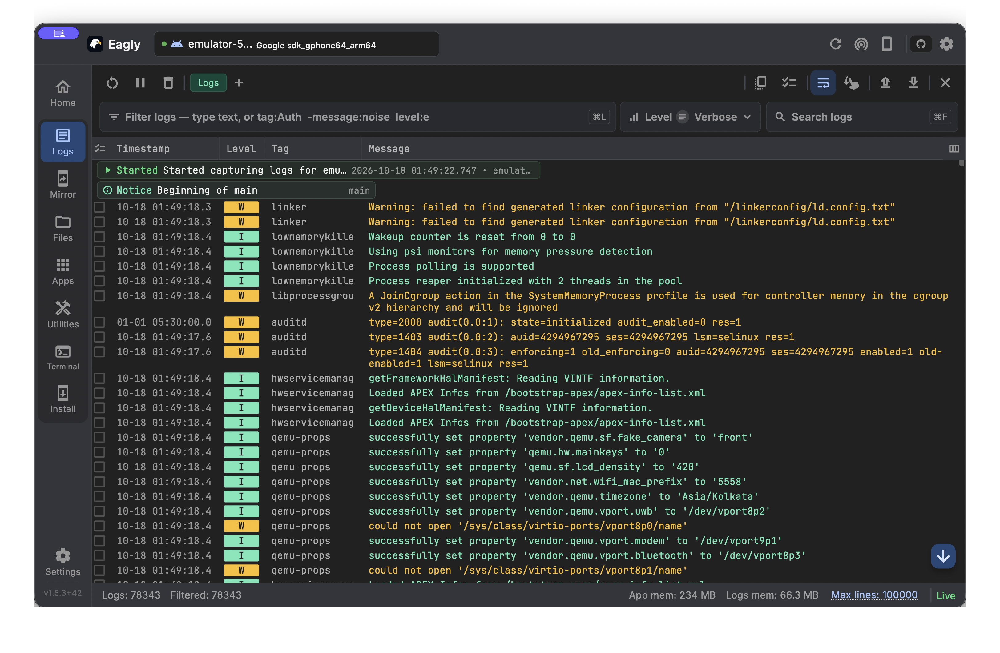 | 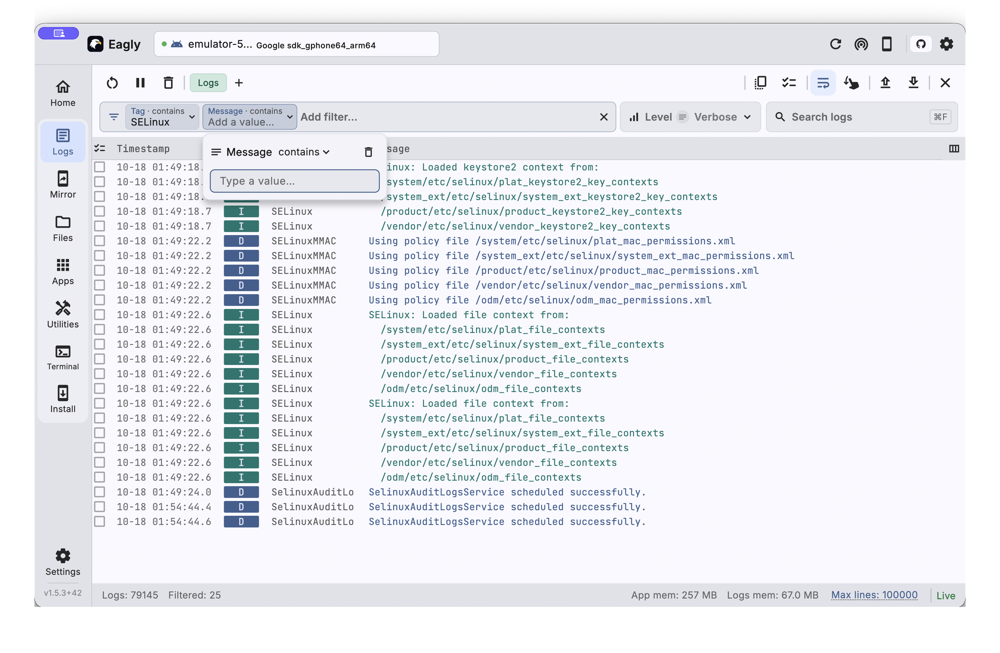 |

### 🪟 Side-by-side workspace
Drag a pane's header to split, stack or tab panes — here Logs and Apps share a tab group,
Utilities sits below, and the mirrored screen runs alongside.

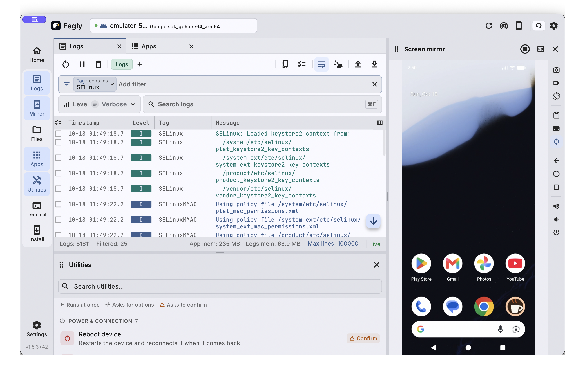

### 🔎 Filtering & regex search
Add a pill per condition — pick a field and how it matches, then type a value — and find
anything with the search box beside it.


| Filtering | Regex search |
|---|---|
| <video src="https://github.com/user-attachments/assets/a93d115b-8899-4c03-895c-3aa0f33dec17" width="400"></video> | <video src="https://github.com/user-attachments/assets/10971f7b-a0a0-418b-a0b7-c70c43b9b77b" width="400"></video> |

### 📲 Screen mirroring & control — *Android*
Mirror the device screen right next to your logs and control it with your mouse and keyboard.

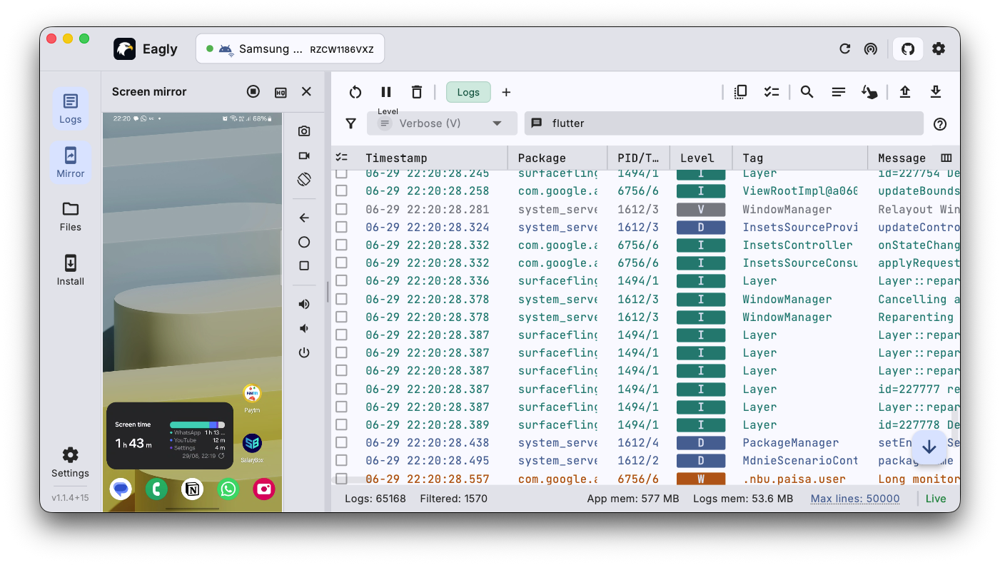

### 📦 Apps
Every installed app with its real name and icon, recently installed ones up top. Right-click
an app to open, force-stop, clear its data or uninstall it.

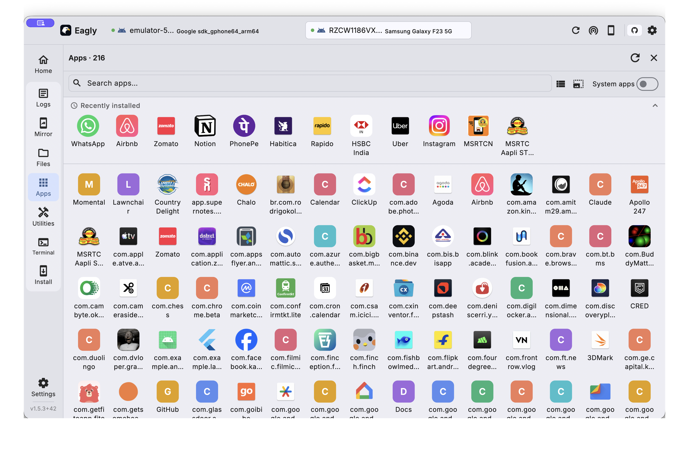

### 🧰 Utilities
Common device commands, grouped and searchable. Each one says whether it runs at once, asks
for options, or asks you to confirm first.

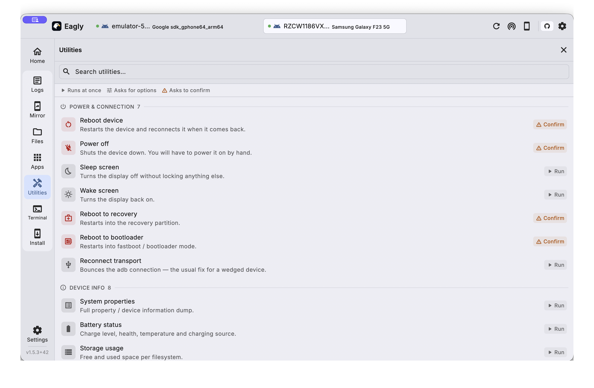

### 💻 Terminal
Run `adb` and `libimobiledevice` commands with the device already selected, in as many tabs
as you need.

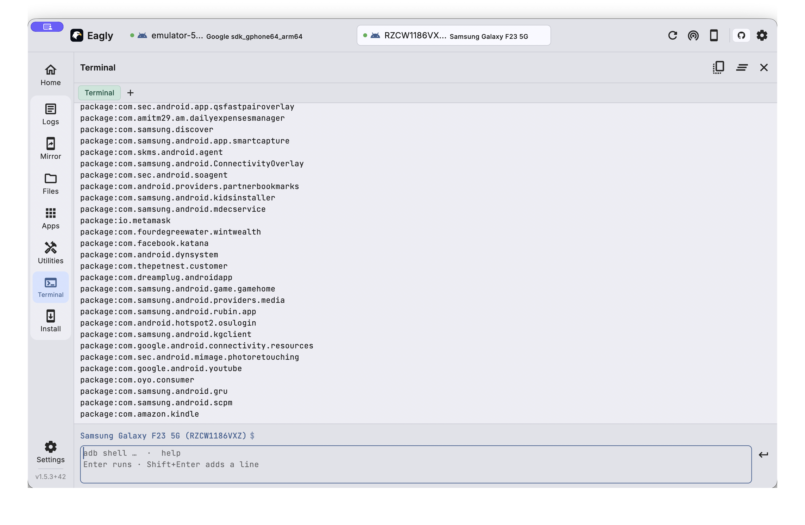

### ⌨️ Command palette
Press **⌘⇧P** / **Ctrl+Shift+P** and type a few letters to find any action or utility.

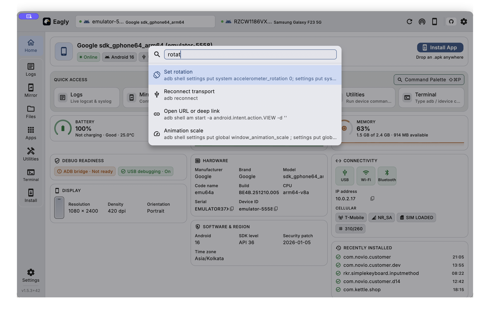

### 🐞 iOS crash reports
Pull and read crash logs from connected iPhones and iPads.

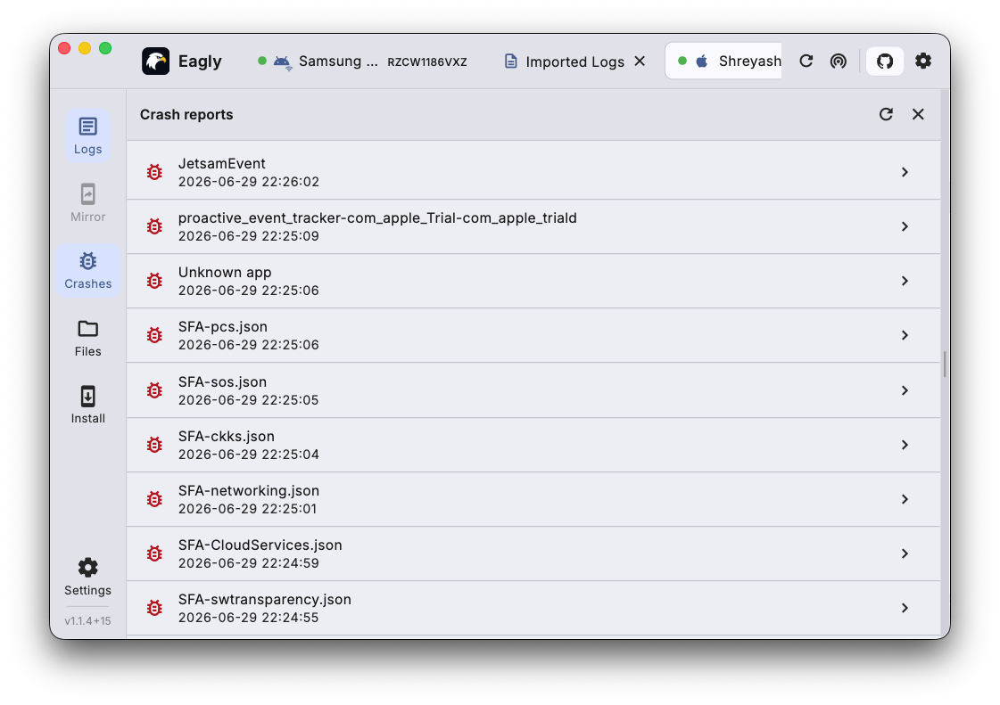
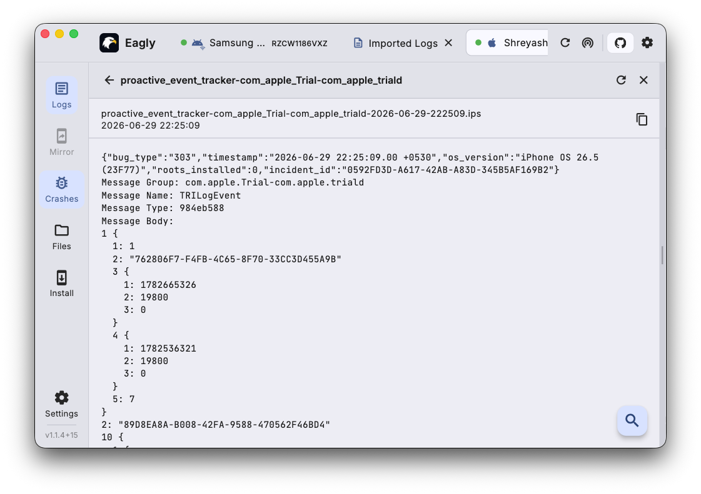

### 📂 File manager
Browse an Android device's filesystem, or an iPhone or iPad's media storage; upload, download
and delete files.

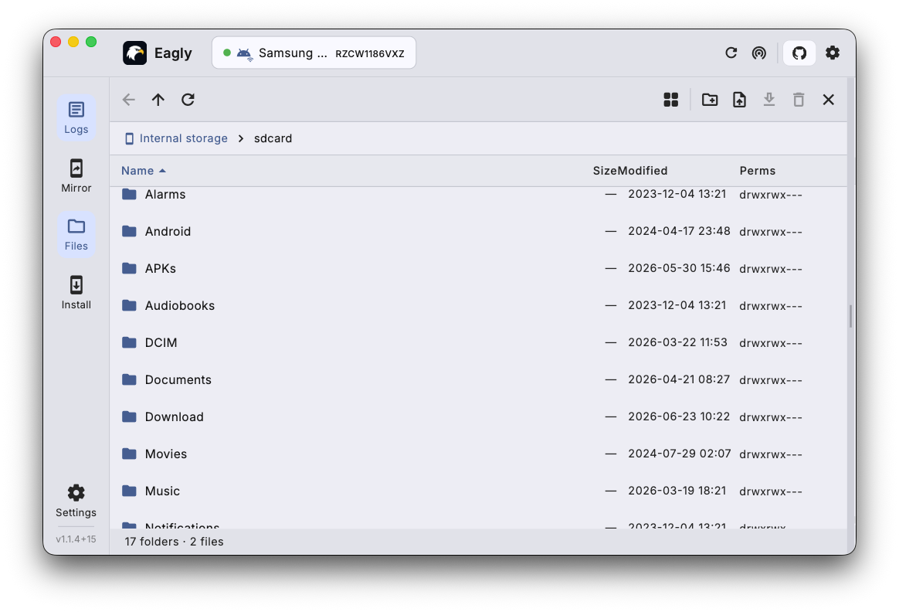

### 🌐 Wireless debugging
Pair and connect to Android devices over Wi-Fi.

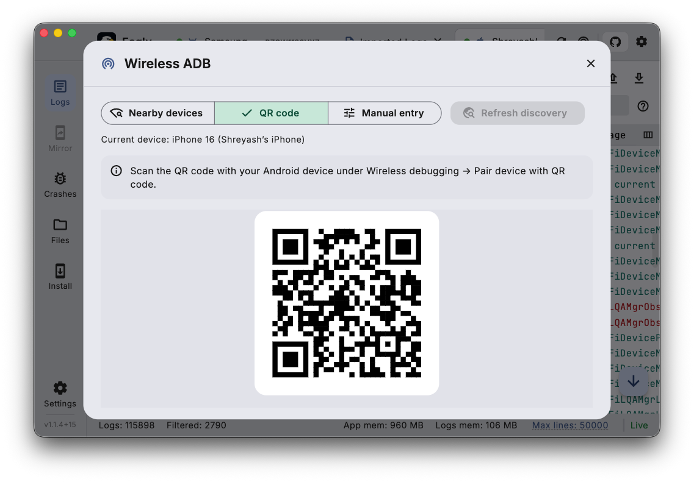

### 🗂️ Import logs
Open previously saved log files in their own workspace tab.

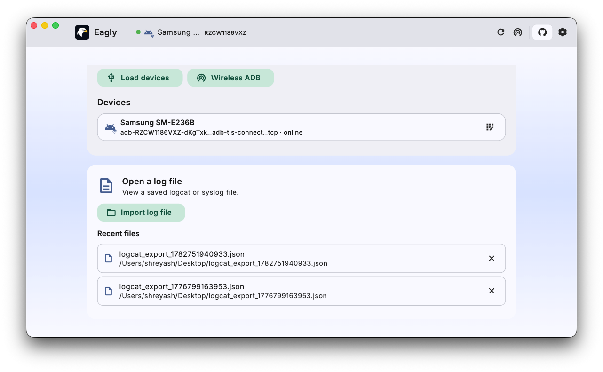

### 🏠 Getting started
A friendly landing screen to pick a connected device, connect over Wi-Fi, or open a saved log file.

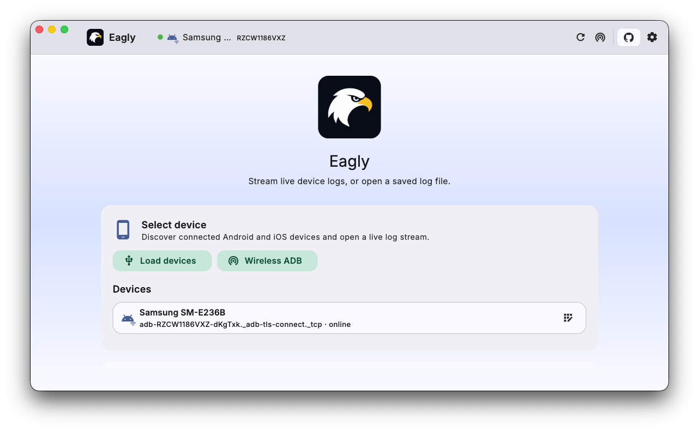

---

## Usage

### Android

1. Enable **Developer Options** on your Android device.
2. Turn on **USB Debugging** (Settings → Developer Options → USB debugging).
3. Connect your device via USB (or use wireless debugging).
4. Launch Eagly — your device should appear automatically.

No physical device? Open the **Emulators** panel — the phone icon in the header, or the
**Emulators** button on the landing screen — to start, cold-boot, wipe, create or delete an
Android emulator, and its tab opens by itself once it finishes booting. This uses the Android
SDK already installed on your machine (the emulator itself is several gigabytes, so Eagly does
not bundle it); if it isn't found automatically, point Eagly at it under
**Settings → Android SDK**.

### iOS — macOS / Linux

1. Connect your iPhone or iPad via USB.
2. When prompted on the device, tap **Trust This Computer** and enter your passcode.
3. Launch Eagly — your device should appear automatically.

> **Apple Silicon Mac (M1 / M2 / M3 / M4) and your iPhone never appears? Update Eagly.**
> Builds **before 1.2.2** bundled Intel-only (x86_64) iOS tools, so on Apple Silicon they
> needed **Rosetta** — without it, iPhones and iPads simply never showed up, with no error.
> **1.2.2 fixes this:** the bundled `libimobiledevice` tools are now universal
> (arm64 + x86_64) and run natively, so **Rosetta is no longer required**.
> Grab the [latest release](https://github.com/ShreyashKore/eagly/releases/latest) and
> reconnect your device. (Your current version is shown under **Settings → About → Version**.)

### iOS — Windows

> **iTunes is required** for iOS device communication on Windows.
> Download and install iTunes from [https://www.apple.com/itunes/](https://www.apple.com/itunes/) or [Apple Devices](https://apps.microsoft.com/detail/9np83lwlpz9k) before connecting your device.

1. Install [iTunes](https://www.apple.com/itunes/) or [Apple Devices](https://apps.microsoft.com/detail/9np83lwlpz9k).
2. Connect your iPhone or iPad via USB.
3. When prompted on the device, tap **Trust This Computer** and enter your passcode.
4. Launch Eagly — your device should appear automatically.

### Filtering logs

Click the filter field (or press **⌘L** / **Ctrl+L**) and pick a field from the
**Filter by…** menu to add a pill, then choose how it matches and enter a value. Every pill
must match, so adding more pills narrows the logs.

You can also type filters straight into the field — each term becomes a pill when you press
Space or Enter. Keys are `tag` (`category` on iOS), `package`, `pid`, `message`, `level` and
`age`; bare words match any field. Prefix a term with `-` to exclude matches, and add `=` or
`~` after the key for an exact or regex match:

```
package:com.myapp level:W -tag:AudioTrackImpl -message~:heartbeat
```

All terms must match, so this shows warnings and above from `com.myapp`, without
`AudioTrackImpl` logs or heartbeat messages.

---

## Building from Source

First-time setup is scripted — run [`scripts/setup.sh`](scripts/setup.sh)
(on Windows, from Git Bash: `bash scripts/setup.sh`). See
[docs/SETUP.md](docs/SETUP.md) for prerequisites and details, and
[docs/CONTRIBUTING.md](docs/CONTRIBUTING.md) for the packaging flow.


## Contributions

<a href="https://github.com/ShreyashKore/eagly/graphs/contributors">
  
</a>