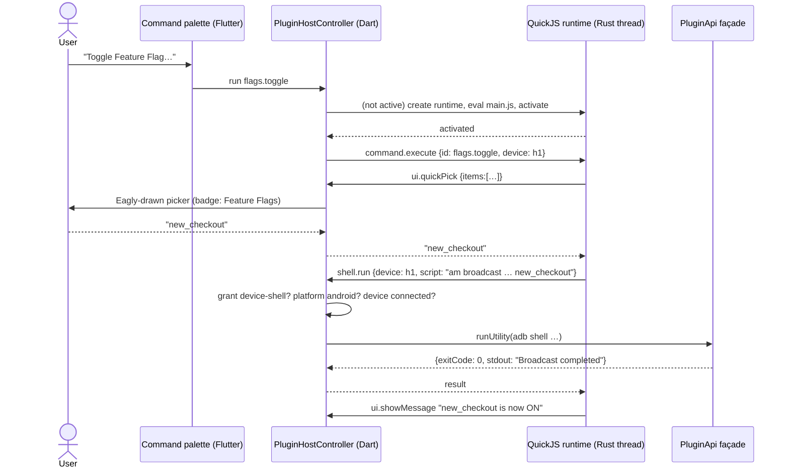

# Plugin system

> **Status: plan, 2026-10-29. Nothing is built.** Eagly is at 1.8.0. Facts about Obsidian and
> VS Code were checked against primary sources on that date. Facts about other apps and
> libraries come from earlier knowledge and are marked *unverified* where a decision depends on
> them ([References](#references)). The author's guide that goes with this plan is
> [PLUGIN_AUTHORING.md](PLUGIN_AUTHORING.md).

**Goal.** Let people outside this repo extend Eagly the way Obsidian, VS Code and Figma let
people extend those apps. A team could add its own device commands, panes, log and network
decoders, file viewers and bug-report exporters without forking Eagly. Eagly should stay fast,
and a plugin should never be able to do more than its user agreed to.

## TL;DR

- **Plugins are TypeScript (or JavaScript), bundled into one file, and run in a QuickJS sandbox
  inside Eagly's Rust layer.** A plugin starts with no file system, sockets, processes or Flutter
  access. Everything it does is a message to Eagly, and Eagly checks the plugin's granted
  permissions on every message. The message protocol is the API and the security boundary, so
  the runtime behind it can change later (WebAssembly, a separate process) without changing
  plugins.
- **Dart is not an option for plugin code.** Flutter release builds are compiled ahead of time
  and cannot load Dart code at run time. Interpreting Dart (`dart_eval`) is possible but gives
  authors a subset of Dart, a small ecosystem and a single-maintainer dependency (§4.1).
- **Permissions are enforced, not just disclosed.** This is the gap Obsidian and VS Code still
  have: their plugins run with the app's full privileges (§2). Eagly can avoid it because it
  starts with a sandbox instead of adding one to an existing API later.
- **UI is declarative.** A plugin describes its pane with Eagly's own components (toolbar, table,
  code view, key–value list, form, empty state), and Eagly draws it. Plugins never ship Flutter
  widgets or HTML in the first phases. Their UI therefore follows the theme, the app zoom and
  keyboard navigation, and it cannot imitate Eagly's permission dialogs.
- **Contributions are declared in the manifest.** Eagly lists a plugin's commands, panes and
  settings without running its code, and starts the code only when one of them is used (lazy
  activation, as in VS Code).
- **Plugins see a small, stable façade, never the controllers.** The façade is the read layer the
  MCP server already has (device resolution, output budgets, header redaction), extracted so
  plugins and agents share one implementation.
- **Distribution** is a registry repo holding an index of plugins. Each entry points to a GitHub
  release asset, with its SHA-256 and a signature. Source must be public and built in CI. Every
  version is scanned automatically, and Eagly checks a revocation list on start-up.
- **Phase 0 ships no plugin code at all.** Declarative packs (utility commands, filter presets,
  highlight rules) cover a large share of what teams want, at a small fraction of the risk and
  work. Scripted plugins follow in phase 1.

## 1. What plugins are for

The use cases that set the scope, most common first:

1. **Team commands.** "Reset onboarding", "toggle the staging backend", "open these deep
   links", "grant the debug permissions": usually `adb shell am broadcast …` with a parameter.
   Today these are personal shell scripts.
2. **Log enrichment.** Parsing a company's structured log format into columns, highlight rules,
   deobfuscating R8 stack traces with a mapping file, and turning repeated errors into a summary.
3. **Network decoders.** Protobuf bodies with the team's `.proto` files, MessagePack, GraphQL
   operation names in the request list, or a custom auth scheme shown in plain words.
4. **File viewers.** An SQLite browser for the Files pane, readable SharedPreferences XML,
   readable `NSUserDefaults` plists.
5. **Bug-report export.** A screenshot, a filtered log excerpt and the failing requests, bundled
   into a Jira, Linear or GitHub issue.
6. **Crash symbolication.** Applying dSYMs to iOS crash reports, or `retrace` to Android traces.
7. **Automation.** "When this log line appears, take a screenshot", or sample memory every 5 s
   and plot it.
8. **Two-sided plugins (later).** A desktop pane paired with a small library inside the app:
   a Redux, Bloc or Riverpod state viewer, a feature-flag editor, a database inspector. This was
   Flipper's main value. Eagly already has a device↔desktop channel in the Inspektor protocol
   (docs/NETWORK_INSPECTOR.md), which could carry it (§9, phase 3).

Out of scope: themes that replace Eagly's look, paid plugins, plugins that change Eagly's own
behaviour by patching it (Obsidian plugins often monkey-patch the app; that is why they break on
updates), and plugins for the iOS or Android app under test (that is Inspektor's job).

## 2. How other apps do it

| App | Plugin code runs | Isolation | Permissions | UI | Distribution and review |
|---|---|---|---|---|---|
| **Obsidian** | JS in the Electron renderer, with Node | None. Its help page says it "cannot reliably restrict plugins" | Since May 2026: plugins will *declare* network, file system and clipboard use, shown before install. Disclosure only | Full DOM access | Registry of GitHub releases. Since 2026-05-12, every version is scanned automatically (code quality, vulnerabilities, malware), with human review for popular and flagged plugins. Closed source is not accepted |
| **VS Code** | Node, in a separate extension-host process | Process only: a crash doesn't take down the UI, but extensions have the editor's full privileges. Permissions have been requested since 2018 (issue #52116) | None. Workspace Trust limits what runs in untrusted folders | Contribution points declared in `package.json`. Webviews are sandboxed iframes talking by `postMessage` | Marketplace with signed packages and publisher verification. Malicious extensions keep getting through screening |
| **Figma** | JS in a sandboxed realm on the main thread | Strong: no DOM and no network in the sandbox | `networkAccess.allowedDomains` in the manifest, enforced | An iframe that talks to the sandbox by messages | Review by Figma |
| **Chrome (MV3)** | JS service worker and content scripts | Strong | Enforced manifest permissions and host permissions. Optional permissions are asked for at run time. New permissions in an update disable the extension until the user accepts | HTML pages of the extension | Web Store review. Remote code is banned |
| **Zed** | WebAssembly (WIT interfaces), built from Rust | Strong | Capabilities granted by the host | Limited, declarative | Registry repo. Zed builds extensions from source |
| **Raycast** | React and TypeScript in a Node worker | Medium | None declared | React components rendered natively by Raycast, not HTML | Every extension lives in one public monorepo, is reviewed there and is built by Raycast |
| **Notion** | No code runs inside Notion. Integrations are external services using the public API | Total: they are other servers | Capabilities (read, update, insert content, comments, user info) plus per-page sharing | None inside Notion | OAuth apps, an integrations gallery |
| **Grafana** | Frontend React, and a backend in Go run as a separate process over gRPC | Process | None | React | Signed plugins at private, community and commercial levels. Unsigned plugins need a config flag |
| **Flipper** (Meta) | JS and React desktop plugins, plus client plugins inside the app SDK | None | None | React | npm. React Native dropped its default Flipper integration in 0.74 (2024) |
| **IntelliJ / Android Studio** | JVM, in-process | None | None | Swing | JetBrains Marketplace. A Plugin Verifier checks API compatibility across IDE versions |

*Unverified, from earlier knowledge:* everything in the table except the Obsidian and VS Code
rows, which were checked on 2026-10-29.

**Lessons that shaped this plan:**

1. **A permission model has to exist from day one.** Both Obsidian and VS Code have spent years
   trying to add one to an API that grants everything. Obsidian's 2026 answer is still
   disclosure without enforcement. Figma and Chrome enforce permissions because their sandbox
   came first.
2. **Declare, then activate lazily.** VS Code's contribution points let it show menus and
   commands before any extension code runs, which keeps start-up fast. Obsidian loads every
   enabled plugin at start-up, and slow plugins slow the app.
3. **A narrow public API ages better than access to internals.** Obsidian plugins reach into
   undocumented internals and break on updates. VS Code and IntelliJ keep a defined API and
   check it (IntelliJ's Plugin Verifier, VS Code's proposed-API gate).
4. **Native-looking declarative UI beats embedded web pages** for consistency (Raycast). Web
   UIs (VS Code webviews, Figma iframes) give more freedom but look foreign and cost memory.
5. **Review cannot be the only defence.** Obsidian moved to scanning every version. Malicious VS
   Code extensions still pass screening. The sandbox and permissions must hold even when a
   malicious plugin is published.
6. **Building from public source helps.** Raycast and Zed build plugins themselves. Obsidian
   refuses closed source. The code that runs is then the code that was reviewed.
7. **Two-sided plugins have high value and high maintenance cost** (Flipper). Defer them, and
   reuse the Inspektor channel instead of shipping a second in-app SDK.

## 3. Constraints Eagly brings

- **AOT Flutter.** Release builds cannot load Dart code: `Isolate.spawnUri` and mirrors are not
  available. Any plugin code needs an interpreter or another runtime.
- **Eagly already ships Rust** through flutter_rust_bridge (`rust/`, built by `hook/build.dart`).
  Embedding a JS engine or WebAssembly runtime there needs no new toolchain, and the result
  ships for all three desktop platforms the same way the iOS backend does.
- **The macOS app is neither sandboxed nor using the hardened runtime**
  (`Release.entitlements`: `app-sandbox` false). Spawning a helper process is allowed. If Eagly
  is ever notarized with the hardened runtime, loading third-party native libraries would need
  the `disable-library-validation` entitlement. That is one more reason never to accept native
  code in plugins.
- **The internals move fast.** Controllers, constructors and file layout change often (the Dart
  3.13 migration, the device-mirror package, the iOS Rust migration). Plugins must see a façade
  that does not move with them.
- **Device resources are shared and fragile:**
  - Android allows one UI Automation connection at a time, which the layout inspector already
    takes (docs/LAYOUT_INSPECTOR.md).
  - Starting QuickTime capture re-enumerates an iPhone and cuts every usbmux connection
    (docs/IOS_SCREEN_MIRROR.md).
  - The log pipeline makes guarantees (no lost, split or reordered lines; docs/LOG_STREAMING.md).

  A plugin must therefore get high-level operations that Eagly schedules, not raw `adb` or
  `idevice*`.
- **The libimobiledevice CLIs will be removed** (AGENTS.md, iOS backends). Exposing them to
  plugins would make that removal break plugins. iOS operations go through the domain API only.
- **Closed seams:**
  - `WorkspacePane` is an enum.
  - Command palette items are built in code (`command_palette_items.dart`).
  - `UtilityCommand.build` is a Dart closure.
  - Settings sections are hard-wired.

  Each needs an open registry or a data form (§9).
- **Existing privacy rules:**
  - `--record-mode` replaces serials and UDIDs with stand-ins.
  - Sentry must not receive device data.
  - The MCP server redacts sensitive headers by default.

  Plugins must inherit all three.
- **The repo has no LICENSE file.** The plugin SDK and the API types need an explicit licence
  before anyone can build on them (§11).

## 4. Options considered

### 4.1 Where plugin code runs

| Option | For | Against |
|---|---|---|
| **A. Dart through `dart_eval`** | Authors write Dart. `dart_eval` has its own permission classes | A subset of Dart, slower than JS engines, binding Flutter widgets is partial, one maintainer. The plugin API would inherit the interpreter's gaps |
| **B. JS/TS on embedded QuickJS** (`rquickjs` in Rust) | The largest pool of authors. TypeScript types make a good API. About 1 MB. No I/O unless the host adds it. Memory limits and an interrupt handler stop runaway plugins | No JIT, so it is slower than V8 (fine for glue code, not for heavy number crunching). npm packages that need Node built-ins don't work. QuickJS has had memory-safety bugs, so in-process isolation is weaker than a separate process |
| **C. WebAssembly** (wasmtime with WIT) | Any language (Rust, Go, AssemblyScript, Kotlin/Wasm). The strongest sandbox. Fuel and epoch limits | Toolchain friction for mobile developers. JS authors would still need an engine. Component-model tooling is still moving. Adds several MB |
| **D. External processes** (any language, JSON-RPC over stdio, like LSP or MCP) | Simple, and anything goes | Full user privileges with no sandbox. Per-OS binaries. This is the Obsidian and VS Code model, with the same problems |
| **E. A bundled Deno or Node** | The npm ecosystem. Deno has permission flags | 50–100 MB or more, plus a second runtime to update and patch |
| **F. Declarative only** (manifest, no code) | No code execution. Trivial to review | Limited to what Eagly anticipates |

**Recommendation: F now, B next, and a protocol that leaves room for C and D.**
- The plugin↔host protocol is JSON-RPC-style messages with JSON Schema for every method (§5.2).
  QuickJS is one runtime that speaks it.
- A WebAssembly runtime can be added later behind the same protocol.
- An external-process runtime could be offered as a separate "unrestricted" class for developers
  only, behind its own warning.

### 4.2 How plugins draw UI

| Option | For | Against |
|---|---|---|
| **Eagly view schema** (recommended) | Built from Eagly's components, so it looks native, follows theme, zoom and text-emphasis tiers, and is accessible. Plugins cannot spoof host dialogs. Easy to review | Only as expressive as the component set. Custom charts need new components |
| **`rfw` (Remote Flutter Widgets)** | Official Flutter package, stable (1.1.x), runs no code | Its widget set is arbitrary and low-level, so plugins would compose raw widgets and drift from Eagly's look. It couples the public format to `rfw`'s. Possibly useful *inside* the renderer, as a local widget library made of Eagly components. Decide in the spike |
| **Webview pane** (later, opt-in) | Anything HTML can do: charts, custom editors | Heavy. Foreign look. Needs a strict CSP and the same message bridge. Desktop webview plugins differ per OS |

## 5. Architecture

```
Eagly app (Flutter, UI isolate)                       lib/features/plugins/
  PluginManager             installed plugins, enable/disable, grants, updates, revocation
  PluginInstaller           download → verify → unpack → validate → consent → commit
  PluginHostController      one per running plugin: routes messages, checks grants,
                            enforces budgets, owns the plugin's disposables
  PluginApi (façade)        devices · logs · network · apps · files · screen · shell ·
                            crashes · ui · storage · http · clipboard · mcp
     │ calls                ─ never AdbTool or services/ios/* directly (same rule as MCP)
     ▼
  shared read layer         extracted from features/mcp/tools: device resolution,
                            budgets, redaction, record-mode stand-ins
     │
  DeviceSessionManager → DeviceSessionController → feature controllers (unchanged)

  Contribution registries   commands · panes · utilities · log rules · body decoders ·
                            file handlers · app actions · exporters · settings · MCP tools
       ▲ manifest (no code needed)            │ messages (JSON) over a flutter_rust_bridge stream
                                              ▼
Rust plugin host                                       rust/src/plugins/
  one OS thread per active plugin, each with its own QuickJS runtime:
  memory limit, interrupt deadline, module loader that resolves only the plugin's bundle,
  no std modules (no os, no fs), a message pump
     └─ plugin main.js  (+ @eagly/plugin-api shim compiled in)
```

### 5.1 Why this shape

- **The message boundary is the security boundary.** The plugin's JS can only post messages.
  Dart checks each one against the grants before calling anything. A bug or a hostile plugin in
  the runtime cannot skip that check: there is no other way out of the sandbox, short of a
  QuickJS memory-safety bug (hence phase 3's separate process).
- **The façade is the stable API.** Its methods take and return plain JSON. Feature controllers
  stay free to change.
- **Sharing the read layer with MCP.**
  - `features/mcp/tools/` already resolves a `device` argument, caps output, redacts headers and
    keeps the Network watcher alive without opening the pane (`holdWatching()`).
  - Plugins need exactly that. Extract it once, so a fix to redaction or budgets reaches both.
  - The argument helpers in `mcp_tool.dart` (`McpArguments`, schema helpers) become the shared
    validation for plugin calls too.
- **One thread per plugin** keeps a slow plugin from delaying another. A runaway loop is
  stopped by the interrupt handler, and Dart never waits on plugin code synchronously.

### 5.2 The protocol

JSON-RPC 2.0 shaped messages in both directions, with `apiVersion` agreed at activation.

| Direction | Kind | Examples |
|---|---|---|
| plugin → host | request | `devices.list`, `logs.query`, `shell.run`, `ui.confirm`, `storage.set`, `http.fetch` |
| plugin → host | notification | `log.write` (to the plugin console), `view.update` |
| host → plugin | request | `activate`, `deactivate`, `command.execute`, `view.render`, `view.action`, `fileHandler.open`, `decoder.decode`, `mcp.callTool` |
| host → plugin | notification | `logs.entries` (batched), `devices.changed`, `network.changed`, `settings.changed` |

Rules:
- Every method has a JSON Schema in Eagly. Arguments are validated before any work is done.
- Every request carries a deadline, and long ones can be cancelled (`$/cancel`).
- Results are capped like MCP tool output (§7.2). What is cut is reported, never cut silently.
- Binary data (screenshots, file contents) moves as handles. The plugin gets a handle and asks
  for bytes in chunks, so a 7 MB iPhone screenshot doesn't cross the boundary unless asked for.
- Errors are typed: `PermissionDenied` (names the permission), `Unsupported` (platform),
  `DeviceDisconnected`, `Cancelled`, `LimitExceeded`, `InvalidArgument`.

### 5.3 The façade (API surface)

| Namespace | Methods | Backed by | Permission |
|---|---|---|---|
| `devices` | `list`, `current`, `get`, `onDidChange` | `DeviceSessionManager`, `DevicesRepository` | `devices:read` |
| `devices` | `identifiers(device)` (serial or UDID) | `Device.id`, a stand-in under `--record-mode` | `devices:identifiers` |
| `logs` | `query`, `subscribe(filter)` | `LogController.logs`, `appendedLogs`, `LogFilters.parse` | `logs:read` |
| `logs` | `annotate(entryId, note)` | a side table drawn by `LogRow` (entries are never changed) | `logs:annotate` |
| `network` | `list`, `get`, `body`, `subscribe` | `NetworkController`, `holdWatching()` | `network:read` |
| `network` | unredacted headers | as above | `network:secrets` |
| `apps` | `list` | `AppsController` | `apps:read` |
| `apps` | `launch`, `forceStop` | `DeviceSessionRepository.launchApp` / `forceStopApp` | `apps:control` |
| `apps` | `install`, `uninstall`, `clearData` | `AppsController`, install flow | `apps:manage` (+ confirmation every time) |
| `files` | `list`, `read` (device) | `FileManagerController` | `device-files:read` |
| `files` | `write`, `delete` (device) | as above | `device-files:write` |
| `screen` | `screenshot` | `captureScreenshot()` | `screen:capture` |
| `shell` | `run` (Android `adb shell` script, one argument, evaluated by the device's `sh`), `quote` | `runUtility()` | `device-shell` |
| `crashes` | `list`, `get` | `CrashReportController` | `crash-reports:read` |
| `ui` | `showMessage`, `confirm`, `quickPick`, `input`, `pickHostFile`, `saveHostFile`, `openPane`, `views.*` | host dialogs, `WorkspaceLayout` | none, rate limited |
| `storage` | `get`, `set`, `delete` (per-plugin key–value, quota) | a JSON file in the plugin's data dir | none |
| `secrets` | `get`, `set` (API keys for exporters) | OS keychain (phase 2) | none, per plugin |
| `http` | `fetch` (HTTPS, allowed hosts only) | `package:http` | `net:<host>` |
| `clipboard` | `writeText` / `readText` | Flutter `Clipboard` | `clipboard:write` / `clipboard:read` |
| `mcp` | tools from the manifest | `McpServerController` registry | `mcp:tools` |

Not offered, on purpose:
- Raw `adb` or `idevice*` invocations, and host shell commands.
- Host file paths outside what the user picks in a dialog (`pickHostFile` returns a handle).
- Changing the user's filters, selection or layout, except `openPane` for the plugin's own pane.
- Writing to log entries. Stopping or restarting log capture.

### 5.4 Contribution points

Declared in the manifest's `contributes`, registered without running plugin code:

| Contribution | Where it shows | Eagly seam | What has to change |
|---|---|---|---|
| `commands` | Command palette (category *Plugins*), app menu, keybindings | `CommandPaletteItem`, `AppMenuController`, `shortcuts.dart` | The palette reads a registry. Plugin keybindings never override Eagly's; conflicts show in Settings |
| `utilities` | Utilities pane, Apps right-click menu (`packageParamKey`) | `UtilityCommand` | A data form of `build`: per-platform argument templates with `{param}` placeholders, each quoted with `shellQuote()`. `systemAppSafe` and confirmation text carry over. Declarative, so phase 0 |
| `panes` | Rail and workspace | `WorkspacePane` enum | An open `PaneDescriptor` registry; plugin pane ids are `plugin.<pluginId>.<pane>`. `WorkspacePane.fromId` already ignores unknown ids, so a saved layout survives an uninstall. `supportsPane` reads the pane's `platforms` |
| `logRules` | Logs pane | `LogRow`, filter bar | Declarative highlight and column-extraction regexes, compiled by Eagly, with a match-time budget. Plugin code never runs inside the log pipeline |
| `logProcessors` | Notices, annotations | `LogController.appendedLogs` | Observe a filtered copy of each flush and annotate. They cannot drop, change or reorder entries |
| `filterPresets` | Filter bar | `LogFilters.parse` | Named filters in the bar's own syntax. Phase 0 |
| `bodyDecoders` | Network detail tabs | `CodeView` | Matched by content type or URL. The plugin returns text plus a language for highlighting |
| `networkSources` | Network pane "Open…" | `NetworkSource` | A plugin-backed adapter (for example, importing a Charles or Proxyman session) |
| `fileHandlers` | Files pane "Open with" | `FileManagerController` | By extension and path glob. Eagly pulls the file and hands the plugin a handle |
| `appActions` | Apps pane right-click menu | `app_utility_menu.dart` | Gets the clicked package |
| `deviceCards` | Device home | `DeviceHomeController` | Small declarative cards |
| `exporters` | "Share…" on a log selection, a request or a screenshot | new | The plugin gets a bundle; the user confirms the destination |
| `settings` | Settings → Plugins → *name* | Settings screen | A JSON Schema form rendered by Eagly |
| `mcpTools` | Agents, through the MCP server | `McpTool` registry | Registered only while both the plugin grant and Settings → MCP "Allow plugin tools" are on |

**Activation events** start the code: `onCommand:<id>`, `onPane:<id>`,
`onDeviceConnected:<android|ios>`, `onFileOpen:<ext>`, `onContentType:<type>`, `onMcpTool:<id>`
and `onStartup`. `onStartup` is discouraged, and the registry asks for a reason.

## 6. From installation to execution

### 6.1 The package

A `.eaglyplugin` file is a zip:

```
eagly-plugin.json        manifest (required)
main.js                  one ES module, bundled by the CLI (omitted by declarative packs)
main.js.map              optional, used by the plugin console
assets/                  icons (SVG/PNG), JSON data, .proto files, …
README.md  LICENSE  CHANGELOG.md
```

Limits:
- 10 MB packed, 2,000 files.
- No executables or native libraries: Mach-O, ELF and PE magic, `.dylib`, `.so`, `.dll`.
- No `.wasm` until the WebAssembly runtime exists.

Manifest:

```json
{
  "id": "dev.acme.feature-flags",
  "name": "Feature Flags",
  "version": "1.2.0",
  "description": "Read and flip Acme's feature flags on a debug build.",
  "author": { "name": "Acme Mobile", "url": "https://github.com/acme" },
  "repository": "https://github.com/acme/eagly-feature-flags",
  "license": "MIT",
  "apiVersion": 1,
  "engines": { "eagly": ">=1.10.0 <2.0.0" },
  "main": "main.js",
  "platforms": ["android"],
  "permissions": [
    { "name": "devices:read", "reason": "Shows flags for the selected device." },
    { "name": "logs:read", "reason": "Reads the flag dump the app logs under the FeatureFlags tag." },
    { "name": "device-shell", "reason": "Sends `am broadcast` to the debug app to flip a flag." }
  ],
  "activationEvents": ["onCommand:flags.toggle", "onPane:flags"],
  "contributes": {
    "commands": [{ "id": "flags.toggle", "title": "Toggle Feature Flag…" }],
    "panes": [{ "id": "flags", "title": "Flags", "icon": "assets/flag.svg", "minWidth": 260 }],
    "settings": {
      "properties": {
        "package": { "type": "string", "default": "com.acme.app.debug", "title": "App package" }
      }
    }
  }
}
```

### 6.2 On disk

```
<app support>/plugins/
  installed.json           id, version, source (registry/file/dev), sha256, enabled,
                           granted permissions, installedAt, lastCrashes
  <id>/<version>/          unpacked, read-only
  <id>/data/               storage.json (quota), cached pulls; removed on uninstall unless kept
  .staging/                in-flight installs; cleared on start-up
  registry-cache.json      the last index and revocation list
```

The previous version is kept until the new one has activated once, so an update can be rolled
back. *To check:* where MSIX packaging puts the app support folder on Windows, and whether it is
virtualised (docs/windows-msix.md doesn't say).

### 6.3 The flow

1. **Find it.**
   - From the registry: Settings → Plugins → Browse. The list comes from the registry's
     `index.json`, with name, author, downloads, verified-author badge, permissions and
     platforms.
   - From a file: Install from File… accepts `.eaglyplugin`, or the file is dropped on the
     window. `handleDroppedPaths` learns the extension.
   - For development: Developer mode → Load Plugin from Folder…
2. **Download.**
   - Fetch the release asset named in the index, over HTTPS, with a size cap.
   - Check its SHA-256 against the index.
   - Check the ed25519 signature against the author's key. The key is pinned on first install;
     a key change needs the registry's countersignature.
3. **Unpack into `.staging/`.** Reject absolute paths and `..` (zip-slip), symlinks, oversized
   entries and native binaries.
4. **Validate the manifest.**
   - Schema.
   - `id` format.
   - `apiVersion` supported by this Eagly, and `engines.eagly` satisfied.
   - Platforms and permission names are known.
   - Every contributed id is namespaced.
   - Activation events refer to declared contributions.
5. **Ask for consent.**
   - One dialog lists each permission in plain words, with the author's `reason` and a risk
     level.
   - Dangerous combinations are spelled out. For example, `network:read` + `net:api.acme.dev`
     reads "can send captured network traffic to api.acme.dev".
   - The dialog is drawn by Eagly and never by the plugin.
6. **Commit.**
   - Move the staged folder to `<id>/<version>/` atomically and write `installed.json`.
   - Register the declarative contributions: the plugin's commands appear in the palette, and
     its pane appears in the rail.
   - No plugin code has run yet.
7. **Activate on the first matching event.**
   - The `PluginHostController` asks Rust for a runtime with limits (§7.2).
   - Rust evaluates `main.js` with a module loader that resolves nothing outside the bundle.
   - The host then sends `activate` with the plugin's settings and Eagly's `apiVersion`.
   - `activate` must finish within 2 s, or the plugin is marked failed and the triggering action
     says so.
8. **Run.** For example, the user picks *Toggle Feature Flag…* from the palette (sequence below).
9. **Render panes.**
   - When its pane is opened, the host sends `view.render`.
   - The plugin returns a view tree, which Eagly validates against the schema and draws.
   - Clicks and form edits come back as `view.action` messages with an action id.
   - The plugin pushes changes with `view.update` (a whole tree; Eagly diffs it).
10. **Deactivate.**
    - Happens when the plugin is disabled, uninstalled or updated, when Eagly quits, and when
      nothing has used it for 10 minutes (idle unload, phase 2).
    - The host sends `deactivate` with a 1 s deadline.
    - The host then disposes everything the plugin registered (subscriptions, holds such as
      `holdWatching()`, timers, open handles) whether or not the plugin cleaned up. The runtime
      is then dropped.
11. **Update.**
    - The index is checked with Eagly's own update check (`updat`), at most daily.
    - An update that adds permissions waits for consent, as Chrome does. Until then the old
      version keeps running with its old grants.
    - An update without new permissions installs in the background if the user allows it.
12. **Uninstall.** Deactivate, unregister, delete the version folders, and ask whether to keep
    the plugin's data.



## 7. Safety

### 7.1 Threats

| Threat | Example | Controls |
|---|---|---|
| A malicious plugin | Reads auth headers from captured traffic and uploads them | Sandbox (no ambient I/O); `network:read` without `network:secrets` gets redacted headers; `http` limited to declared hosts; combination warning at consent |
| A hijacked author account or update | Version 1.3 adds exfiltration | Signatures pinned per author; every version scanned; new permissions need consent; the revocation list; public source built in CI |
| A buggy plugin | Infinite loop, a memory leak, a flood of messages | Interrupt deadline, memory limit, message rate and queue limits, auto-disable after repeated failures |
| Harm to the device | `pm clear`, `rm -rf /sdcard`, uninstalling the wrong app | `device-shell` is the highest risk tier; `apps:manage` and `device-files:write` confirm every time in an Eagly dialog naming the plugin, device and action; system apps refused (the `systemAppSafe` rule) |
| Spoofed UI | A pane that looks like Eagly's permission dialog | Declarative UI only; plugin content is always framed by host chrome with the plugin's name; permission dialogs are drawn by the host only |
| Disrupting Eagly | Holding the UI Automation connection, or many adb calls in parallel | High-level operations only, scheduled by Eagly; per-device concurrency limits; no raw `adb`/`idevice*` |
| Data leaking into screen recordings or bug reports | Serials shown in a pane under `--record-mode` | Plugins get opaque device handles; serials need `devices:identifiers` and are stand-ins in record mode |
| Plugins and agents | An agent calls a plugin's MCP tool that runs a shell command | Plugin MCP tools are off unless the plugin grant *and* the MCP "Allow plugin tools" switch are on; destructive ones still confirm in Eagly |
| Device text treated as code | A log line contains markup or instructions | Views render text as text; no HTML; the guide tells authors that device data is untrusted |
| A QuickJS sandbox escape | A memory-safety bug in the engine | Keep `rquickjs` updated; phase 3 moves the runtime into a separate, OS-sandboxed process |

### 7.2 Limits (defaults, tunable as `@visibleForTesting static` fields like the rest of the app)

| Resource | Limit | When exceeded |
|---|---|---|
| Memory per runtime | 64 MB | The allocation fails, the plugin is stopped and the user is told |
| One handler (activate, command, render) | 2 s of CPU before the interrupt fires; 30 s wall time for awaited host calls | `LimitExceeded`; the action reports failure |
| Messages to the host | 200 per second, at most 64 in flight | Queued, then `LimitExceeded` |
| `logs.entries` delivery | Batched on the 300 ms flush, ≤ 2,000 entries and ≤ 1 MB per batch, host-side filtered | Older entries dropped with a `dropped` count; the log pipeline never waits for a plugin |
| Result sizes | MCP budgets: 4 KB per log message, 64 KB per body by default (1 MB max), 512 KB per response | `truncated: true` and counts |
| `storage` | 5 MB per plugin | `LimitExceeded` |
| `http.fetch` | Declared hosts, HTTPS, 10 MB response, 30 s | Error |
| Notifications | 3 per minute | Collapsed into one |
| Crashes | 3 in 10 minutes | Disabled, with an *Enable again* button and a link to the console |

### 7.3 Permissions and risk levels

| Level | Permissions | Consent |
|---|---|---|
| Low | `devices:read`, `apps:read`, `crash-reports:read`, `clipboard:write`, `logs:annotate` | Listed at install |
| Medium | `logs:read`, `network:read`, `screen:capture`, `device-files:read`, `devices:identifiers`, `net:<host>`, `clipboard:read`, `mcp:tools` | Listed with the reason, highlighted |
| High | `network:secrets`, `apps:control`, `device-files:write`, `apps:manage`, `device-shell` | Install consent; `apps:manage` and `device-files:write` also confirm each action; `device-shell` is described as "can do anything adb can do on the device" |

Permissions can be revoked one by one in Settings → Plugins. A revoked permission makes
those calls fail with `PermissionDenied`, and the plugin should degrade (the guide says how).
*Optional permissions*, asked for at run time, are a phase-2 idea borrowed from Chrome.

### 7.4 Supply chain

- **The registry is a GitHub repo** (`ShreyashKore/eagly-plugins`), like Obsidian's original
  `obsidian-releases`. It holds:
  - `index.json`: id, repo, author key, versions, SHA-256, permissions, verified flag;
  - `revoked.json`: ids and versions, with a reason;
  - the registry's own signing key, pinned in Eagly.
- **Submitting** is a PR adding the repo. The registry's CI then:
  - builds the tagged source with the SDK CLI and compares the output with the release asset;
    a mismatch is rejected;
  - runs the validator and a static scan (`eval`, `Function`, obfuscation, dynamic `import`,
    undeclared hosts in string literals);
  - checks provenance (GitHub artifact attestations);
  - needs a human review for the first version, for any version that adds a High permission,
    and for flagged ones.
- **Every later version is scanned**, as Obsidian has done since May 2026.
- **Eagly checks `revoked.json`** on start-up and with every update check. A revoked version is
  disabled at once, with the reason shown.
- **Safe mode:**
  - `--safe-mode`, or holding Shift during launch, starts Eagly with every plugin disabled.
  - After a crash during a plugin's activation, the next launch offers safe mode.
- **Team policy:** an optional `plugins-policy.json` next to the preferences (or set by MDM) can
  allow-list ids, turn off the public registry, or add a private one. This is planned in phase 2,
  because teams with internal plugins ask for it first.

### 7.5 What this cannot promise

Write these into the consent text and the user guide:
- A plugin with `device-shell` can do anything adb can do on that device.
- A plugin with `logs:read` and a network host can send logs to that host. The combination
  warning makes this visible; it doesn't stop it.
- Until phase 3, a QuickJS memory-safety bug could escape the sandbox into Eagly's process.
- Review and scanning reduce risk but miss things. Obsidian and VS Code both have incidents to
  show for it.

## 8. The language and the SDK

- **TypeScript is the recommended language; plain JS works.** The CLI bundles the plugin with
  esbuild into one ES2023 module, with every import inlined.
- **No Node built-ins.** `fs`, `child_process`, `net` and `http` fail the build with a message
  pointing at the Eagly API.
- **Available globals:** `console` (to the plugin console), `setTimeout`/`setInterval` (host
  timers, cleared on deactivate), `URL`, `TextEncoder`/`TextDecoder`, `AbortController`,
  `crypto.getRandomValues`, `structuredClone`, and `fetch`. `fetch` is a shim over `http.fetch`,
  so the allowed hosts apply.
- **npm packages:** pure-JS packages work if they bundle (protobufjs, msgpack, date-fns).
- **Packages:**
  - `@eagly/plugin-api`: types, `definePlugin`, the view builders, the runtime shim.
  - `@eagly/plugin-cli`:
    - `create`: templates for a command, a pane, a decoder and a declarative pack;
    - `dev`: watches, rebuilds and reloads into a running Eagly through Developer mode, with a
      local token;
    - `build`, `validate`, `pack`, `sign` and `publish`. `publish` opens the registry PR.
  - `@eagly/plugin-testing`: a fake host with devices, log fixtures, HAR fixtures and a
    permission switchboard, for unit tests in Vitest or Jest.
- **API versioning:**
  - `apiVersion` is an integer. Eagly supports the current version and the one before it.
  - Additive changes ship without a bump, and plugins check for them with
    `eagly.api.has('network.subscribe')`.
  - Removals bump the version and are announced a release ahead.
  - New APIs ship behind `"enabledApiProposals"` and work only in Developer mode, as in VS Code.
- **Why not Kotlin, Swift or Dart?** Kotlin, Swift and Dart are what mobile developers write
  every day, but none of them can run inside a Flutter AOT app. WebAssembly (phase 3) opens the
  door to Rust, Go and Kotlin/Wasm for authors who want them.

## 9. Changes needed in Eagly

### Phase 0: declarative packs, no plugin code (small, ship first)

1. A **data form of `UtilityCommand`**:
   - per-platform argument templates with `{param}` placeholders, quoted with `shellQuote()`;
   - `null` where a platform has no equivalent, as today;
   - built-in commands can stay as closures.
2. **Filter presets** and **log highlight rules**, both declarative (compiled regexes with a
   match-time budget, colour tokens from `EaglyTheme`, never hex).
3. **The manifest parser and validator, and the installer** (§6.3, steps 2–6), with the
   `installed.json` store and Settings → Plugins (list, enable, remove, permissions).
4. Packs with no `main`. These are the same `.eaglyplugin` files, so phase 1 adds code without a
   new format.

### Phase 1: the runtime and the core API

1. **`rust/src/plugins/`.** An `rquickjs` runtime per thread, memory limit, interrupt handler,
   a module loader limited to the bundle, and a message pump exposed through flutter_rust_bridge
   as a stream in and a sync send out. Only the plugin feature imports the generated bindings,
   following the `Rust*` rule for `lib/src/rust/**`.
2. **`lib/features/plugins/`.** `PluginManager`, `PluginInstaller`, `PluginHostController`, the
   message router with schema validation, grants and limits, and a **Plugin console** in the app
   log (`features/app_log/`), filterable by plugin.
3. **Extract the shared read layer** from `features/mcp/tools/` into `lib/services/agent_api/`
   (name to taste). MCP tools and `PluginApi` both call it.
4. **Open registries:**
   - the command palette (`command_palette_items.dart` merges plugin items);
   - panes: `WorkspacePane` → `PaneDescriptor`. Built-in panes keep their enum for code that
     switches on them, and plugin panes join the descriptor list;
   - settings sections;
   - the utilities catalog.
5. **The view renderer.** A schema and a widget per component, built from existing pieces:
   - `FeatureViewHeader` and `ToolbarAction`;
   - `CodeView`, a `SuperListView` table, `ComboField`;
   - `CenteredStateMessage` with `RetryButton`, and `HintNote`;
   - `AppIconButton`, and text in the three emphasis tiers.
6. **Activation events** wired to palette, pane open, device connect, file open and content type.
7. **The SDK repo** (`eagly-plugin-sdk`, MIT): the three packages, templates and TypeDoc API
   reference. Sample plugins: feature flags, a protobuf decoder, an SQLite viewer and a Jira
   exporter. They double as Eagly's API contract tests in CI.
8. **Tests:**
   - protocol schemas;
   - each permission denied;
   - each limit (a loop, an allocation bomb, a message flood);
   - zip-slip and binary rejection;
   - deactivate cleanup (no holds or timers left);
   - log-pipeline guarantees unchanged with a slow processor attached
     (`test/device/log_stream_integrity_test.dart`);
   - widget tests of the renderer.
9. **Docs:**
   - a new file in docs/ gets what is built, and this file keeps only what is left (see
     [README.md](README.md));
   - an AGENTS.md domain note;
   - the user guide on what permissions mean.

### Phase 2: distribution and trust

The registry repo and its CI (build from source, scan, provenance), signing in the CLI, the
in-app browser, updates with permission diffs, `revoked.json`, safe mode, `secrets` on the OS
keychain, idle unload, optional permissions, and team policy.

### Phase 3: hardening and reach

- **An out-of-process host.**
  - `eagly-plugin-host`, a small Rust binary shipped next to the bundled tools, with the same
    protocol over a pipe.
  - OS sandboxing: Landlock and seccomp on Linux, a sandbox profile or App Sandbox child on
    macOS, an AppContainer or restricted token with a job object on Windows. Each is
    *unverified* for our packaging.
  - A crash or a QuickJS bug then cannot reach Eagly's memory.
- **A WebAssembly runtime** (wasmtime with WIT) behind the same protocol.
- **Two-sided plugins.** A plugin channel multiplexed on the Inspektor socket, so a plugin talks
  to its own in-app library with the trust model of docs/NETWORK_INSPECTOR.md §4.3.
- **Webview panes** with a strict CSP and the same message bridge, for charts and editors that
  the components can't express.

## 10. General challenges and how this plan answers them

| Challenge | Seen in | Answer here |
|---|---|---|
| Plugins break on every app update | Obsidian (internal APIs), IntelliJ | A façade with an integer `apiVersion`, two versions supported, sample plugins as contract tests in CI |
| Start-up gets slower with each plugin | Obsidian | Manifests registered without code; lazy activation; `onStartup` needs a reason; idle unload |
| No permission model can be added later | VS Code, Obsidian | Sandbox and enforced permissions from the first scripted release |
| Malicious plugins pass review | VS Code Marketplace, Obsidian | Sandbox, built from source, every version scanned, signatures, revocation |
| UI that looks bolted on | VS Code webviews, Flipper | Declarative UI from Eagly's components |
| One plugin's bug takes down the app | Obsidian, IntelliJ (in-process) | Thread per plugin, limits, auto-disable, safe mode; separate process in phase 3 |
| Leaked listeners and timers | Every plugin system | The host owns disposables and cleans up on deactivate whether or not the plugin did |
| Plugins fight over keys and ids | Obsidian, VS Code | Namespaced ids; Eagly's bindings win; conflicts shown |
| The firehose problem | Log viewers, Flipper | Host-side filtering, batching on the existing 300 ms flush, dropping with counts, never back-pressuring the log pipeline |
| Review doesn't scale for one maintainer | Obsidian (moved to automation) | Automation first; humans only for first versions, High permissions and flags |

## 11. Points that are easy to miss

1. **Do you need scripted plugins yet?**
   - Phase 0's packs plus the MCP server (agents can already drive Eagly) may cover most
     requests.
   - Ship phase 0, watch what people build, and let that decide phase 1's API.
   - A public API is a promise kept for years by one maintainer.
2. **The plugin API slows internal refactors.** Every feature controller the façade touches is
   now behind a contract. Keep the façade small and add to it only when a real plugin needs
   something.
3. **The log pipeline's guarantees.** No plugin code inside parsing or flushing. Processors
   observe copies (LOG_STREAMING.md).
4. **Device contention.** One UI Automation connection on Android, the usbmux reset on iPhone
   capture, adb concurrency. Plugins get scheduled high-level calls only.
5. **The libimobiledevice CLIs go away.** Never expose them, or their removal breaks plugins.
6. **Platform parity.** Every API method says what it does on Android and iOS, and returns
   `Unsupported` rather than pretending. iOS has no shell.
7. **Record mode and identifiers.** Opaque device handles by default. Serials and UDIDs are
   personal data in a screen recording.
8. **MCP crossover.** Plugin tools reach agents only with two switches on. Plugin output is
   untrusted text for the agent, too.
9. **Licensing and terms.** The repo has no LICENSE. The SDK needs one (MIT is usual), and the
   registry needs terms: what is allowed, takedowns, naming ("Eagly" in a plugin name), and id
   squatting.
10. **A security contact.** A `SECURITY.md` and a way to report a malicious plugin, with a
    revocation SLA.
11. **Sentry.** Plugin errors are tagged with plugin id and version only, never with arguments
    or results. They are excluded from Eagly's crash-free rate so a bad plugin doesn't hide app
    regressions.
12. **Updating Eagly itself.** Before installing an Eagly update, list the plugins its
    `apiVersion` would disable. After it, say which were disabled and why.
13. **Accessibility, zoom and the text-emphasis tiers** come free with declarative UI, but only
    if the schema has no escape hatch (no hex colours, no fixed pixel fonts, labels required on
    icon buttons).
14. **Offline and private use.** Install from file, a private registry URL, and policy files for
    teams that can't publish their internal plugins.
15. **Settings sync and backup.** Decide whether plugin settings travel with an exported Eagly
    config (secrets never do).
16. **Performance visibility.** Settings → Plugins should show each plugin's activation time,
    memory and message rate, so users can find the slow one without guessing.
17. **Windows MSIX and Linux packages.** Check where the plugins folder ends up and that it stays
    writable (MSIX virtualisation), and that the Rust host builds into each package.
18. **Docs are part of the product.** A docs site generated from the SDK, the samples, and
    PLUGIN_AUTHORING.md. Most of a plugin ecosystem's quality comes from its examples.

## 12. Open questions

1. **Is QuickJS fast enough** for log processors at a few thousand lines a second, with
   host-side filtering in front? Spike: a processor that parses JSON logs at 5,000 lines/s, and
   measure the UI frame time.
2. **`rquickjs` versus `boa`** (pure Rust: memory-safe, slower, less complete). A pure-Rust
   engine would weaken the case for phase 3's separate process.
3. **Our own view schema, or `rfw` underneath it?** Spike both on the Feature Flags sample.
4. **Should `device-shell` exist in phase 1,** or only the declarative utility templates (which
   are reviewable and quoted)? Most team commands fit the templates.
5. **Per-device grants?** "Allow on this device" for High permissions, in case a plugin should
   touch a test phone and never a personal one.
6. **Should panes be shared between plugins** (a plugin adds a tab to another's pane), or kept
   strictly separate? Separate is simpler and safer.
7. **Registry hosting.** A GitHub repo (simple, transparent) or a small service (search,
   download counts, scanning dashboards, like Obsidian's 2026 Community hub)? Start with the repo.
8. **Should Eagly ever offer an "unrestricted" external-process class** for in-house tools? If
   yes, only through team policy and never from the public registry.

## References

Checked 2026-10-29:

- Obsidian, [The future of Obsidian plugins](https://obsidian.md/blog/future-of-plugins/)
  (2026-05-12): automated review of every version, capability disclosures, the Community hub.
- Obsidian, [Plugin security](https://obsidian.md/help/plugin-security): plugins inherit the
  app's access; Obsidian cannot reliably restrict them.
- VS Code, [issue #52116](https://github.com/microsoft/vscode/issues/52116) (extension
  permissions, open since 2018); [Extension host](https://code.visualstudio.com/api/advanced-topics/extension-host);
  [Activation events](https://code.visualstudio.com/api/references/activation-events).
- Reports of malicious VS Code extensions passing Marketplace screening, for example
  [SC Media](https://scworld.com/news/vscode-extensions-with-malicious-code-installed-229m-times)
  and [Endor Labs](https://www.endorlabs.com/learn/introducing-package-firewall-for-vs-code-extensions-detect-and-block-malicious-extensions-from-the-ide).
- [`rfw`](https://pub.dev/packages/rfw) (1.1.x, "relatively stable", widget set limited by design).

From earlier knowledge, not re-checked:

- Figma, [How plugins run](https://www.figma.com/plugin-docs/how-plugins-run/) and the manifest's
  `networkAccess`.
- Chrome, [Declare permissions](https://developer.chrome.com/docs/extensions/develop/concepts/declare-permissions).
- Zed, [Developing extensions](https://zed.dev/docs/extensions/developing-extensions).
- Raycast, [Publish an extension](https://developers.raycast.com/basics/publish-an-extension).
- Notion, [Capabilities](https://developers.notion.com/reference/capabilities).
- Grafana, [Plugin management](https://grafana.com/docs/grafana/latest/administration/plugin-management/).
- [`rquickjs`](https://github.com/DelSkayn/rquickjs), [Wasmtime](https://docs.wasmtime.dev/),
  [Extism](https://extism.org/), [`dart_eval`](https://pub.dev/packages/dart_eval).

In this repo: [MCP_SERVER.md](../docs/MCP_SERVER.md) (the read layer, budgets, redaction, the threat
model for a local server), [NETWORK_INSPECTOR.md](../docs/NETWORK_INSPECTOR.md) §4.3 (the Inspektor
channel's trust model), [LOG_STREAMING.md](../docs/LOG_STREAMING.md),
[WORKSPACE_LAYOUT.md](../docs/WORKSPACE_LAYOUT.md), [IOS_RUST_MIGRATION.md](../docs/IOS_RUST_MIGRATION.md),
[LAYOUT_INSPECTOR.md](../docs/LAYOUT_INSPECTOR.md).
